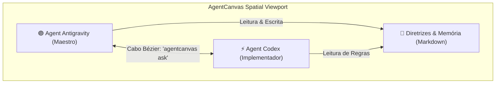
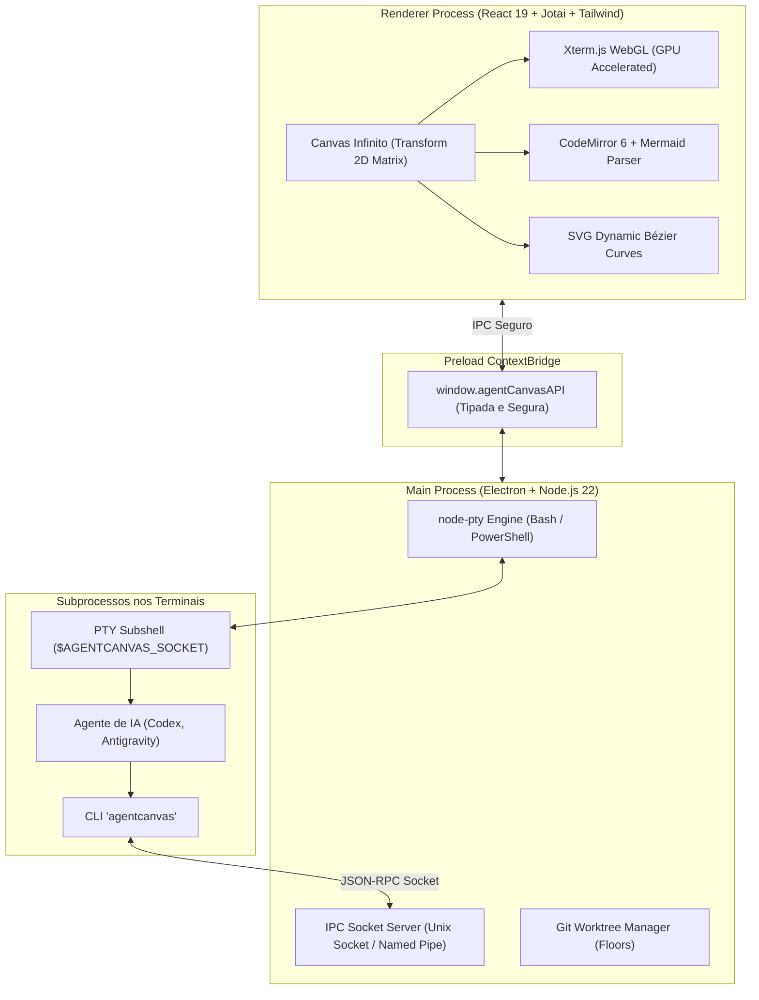

# 🚀 AgentCanvas

<div align="center">
  
  <h1>AgentCanvas</h1>
  <p><strong>Spatial AI Agent Canvas Workspace for Linux & Windows</strong></p>
  <p>Conecte agentes de inteligência artificial em um canvas 2D infinito com terminais PTY WebGL, notas sincronizadas e cabos Bézier luminosos em Preto e Roxo Neon.</p>

  <p>
    
    
    
    
    
    
  </p>
</div>

---

## 🌟 O Que é o AgentCanvas?

O **AgentCanvas** é um ambiente de trabalho espacial de código aberto projetado para a nova era do desenvolvimento assistido por agentes de inteligência artificial (**Antigravity**, **Codex**, **Claude Code**, etc.). 

Em vez de alternar entre várias abas de terminal desconectadas, o **AgentCanvas** coloca todos os seus agentes, notas técnicas e diagramas em um único plano bidimensional infinito. Você conecta os nós através de **cabos visuais inteligentes**, permitindo que os agentes conversem entre si, passem contexto e trabalhem em paralelo em branches isoladas sem conflitos.



---

## ✨ Funcionalidades Principais

- 🌌 **Infinite 2D Spatial Canvas**: Viewport com pan e zoom suaves, paralaxe em grid pontilhado e renderização acelerada.
- ⚡ **Terminais PTY Reais com WebGL**: Emulação nativa com `@xterm/xterm` e `node-pty`, suportando Bash/Zsh no Linux e ConPTY (PowerShell/CMD) no Windows.
- 💜 **Estética Preto & Roxo Neon**: Paleta imersiva *Cyber Obsidian* (`#08070D`) com toques em *Electric Violet* (`#8B5CF6`, `#A855F7`), inspirada em ferramentas como Linear e Raycast.
- 🔌 **Cabos SVG Bézier Conectores**: Cabos dinâmicos com curvas cúbicas e pulso luminoso conectando agentes e notas.
- 📡 **Servidor Socket IPC Integrado**: Unix Domain Sockets no Linux (`/tmp/agentcanvas-*.sock`) e Named Pipes no Windows (`\\.\pipe\agentcanvas-*`).
- 🤖 **CLI Companheiro (`agentcanvas`)**: Comando CLI injetado no terminal para orquestração entre agentes (`ask`, `list`, `check`, `note`).
- 🌳 **Isolamento de Níveis (Git Worktrees / Floors)**: Criação de branches isoladas no disco sem duplicação de repositório.
- 📝 **Editor de Notas Markdown**: Suporte completo a Markdown, diagramas Mermaid dinâmicos e renderização em tempo real.

---

## 🏗️ Arquitetura do Sistema



---

## 🤖 Como Usar o CLI Companheiro (`agentcanvas`)

Dentro de qualquer terminal aberto no canvas, a ferramenta de linha de comando `agentcanvas` está automaticamente disponível via variáveis de ambiente injetadas (`$AGENTCANVAS_SOCKET` / `$AGENTCANVAS_PIPE`):

### 1. Listar Agentes e Recursos no Canvas
```bash
agentcanvas list
```
*Retorna a lista de todos os nós de agentes, identificadores e notas disponíveis.*

### 2. Enviar Prompt para Outro Agente (`ask`)
```bash
agentcanvas ask "Agent Codex" "Implemente os testes unitários do módulo de autenticação"
```
*Injeta o prompt no terminal de destino e notifica o agente.*

### 3. Verificar Saída do Terminal de um Agente (`check`)
```bash
agentcanvas check "Agent Codex" 30
```
*Lê as últimas 30 linhas do buffer do terminal do agente para acompanhar o progresso.*

### 4. Ler ou Escrever em Notas do Canvas
```bash
# Ler uma nota existente
agentcanvas note read "Diretrizes"

# Atualizar o conteúdo de uma nota
agentcanvas note write "Diretrizes" "# Novas regras de negócio..."
```

---

## 🎮 Controles e Navegação no Canvas

| Ação | Atalho / Gesto |
| :--- | :--- |
| **Pan (Mover Canvas)** | Segurar Botão do Meio do Mouse **OU** Segurar `Espaço` + Botão Esquerdo |
| **Zoom In / Out** | Roda do Mouse (`Wheel`) |
| **Resetar Visualização** | Botão `↺` na barra superior |
| **Mover Nó** | Clicar e arrastar a barra de título do nó |
| **Redimensionar Nó** | Clicar e arrastar o canto inferior direito do nó |
| **Adicionar Terminal** | Botão `+ Terminal` na barra superior |
| **Adicionar Nota** | Botão `+ Nota` na barra superior |

---

## 📦 Como Instalar e Rodar

### Pré-requisitos
- **Node.js**: Versão `>= 20` (recomendado Node 22).
- **npm** ou gerenciador de pacotes equivalente.
- **Git** instalado no sistema.

### 1. Clonar o Repositório
```bash
git clone https://github.com/guilhermebarcelos06/AgentCanvas.git
cd AgentCanvas
```

### 2. Instalar Dependências
```bash
npm install
```

### 3. Iniciar em Modo de Desenvolvimento
```bash
npm run dev
```

### 4. Compilar os Pacotes de Produção

#### Para Linux (Ubuntu / Debian):
```bash
npm run build:linux
```
*Gera o pacote `.AppImage` (executável portátil) e o `.deb` em `dist/`.*

#### Para Windows (10 / 11):
```bash
npm run build:win
```
*Gera o instalador NSIS `.exe` e o binário portátil `.zip` em `dist/`.*

---

## 📂 Estrutura do Projeto

```text
AgentCanvas/
├── .github/workflows/build.yml     # Pipeline de CI/CD para Linux e Windows
├── cli/                            # CLI companheiro 'agentcanvas'
│   └── src/                        # Conector de socket e comandos
├── resources/                      # Identidade visual, logo SVG e ícones PNG
├── src/
│   ├── main/                       # Processo principal Electron (PTY, Sockets, Worktree)
│   ├── preload/                    # ContextBridge tipada e segura
│   └── renderer/                   # Interface gráfica React 19 (Canvas, Xterm, CodeMirror)
├── electron-builder.yml            # Configuração de empacotamento desktop
├── electron.vite.config.ts         # Configuração Vite
└── tailwind.config.js              # Configuração do tema Preto e Roxo Neon
```

---

## 📄 Licença
Distribuído sob a licença **MIT**. Veja `LICENSE` para mais detalhes.

---

<div align="center">
  <sub>Construído com carinho para a comunidade de desenvolvedores e agentes autônomos por <a href="https://github.com/guilhermebarcelos06">Guilherme Barcelos</a>.</sub>
</div>
