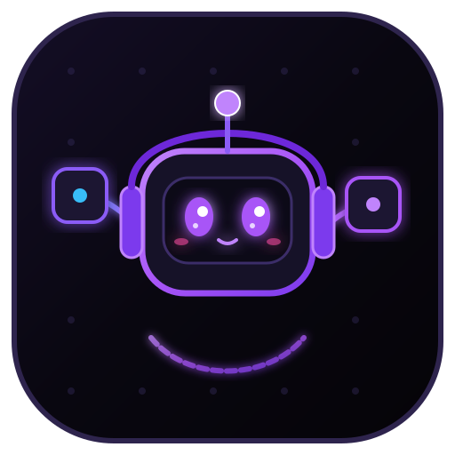
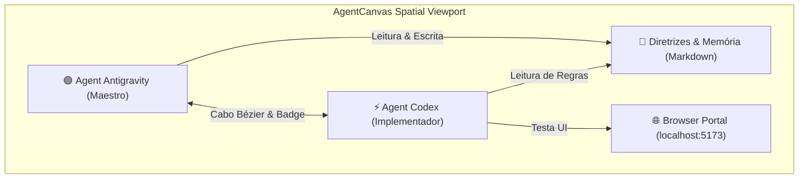
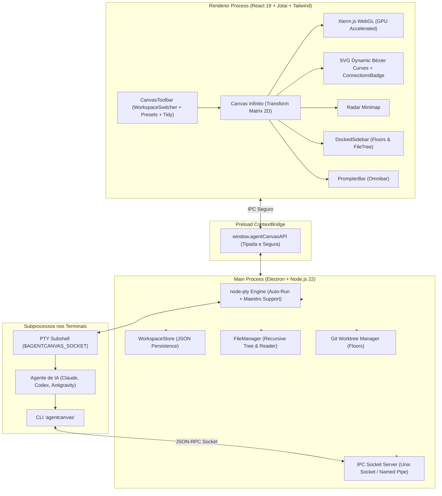

# 🚀 AgentCanvas

<div align="center">
  
  <h1>AgentCanvas</h1>
  <p><strong>Spatial AI Agent Canvas Workspace for Linux & Windows</strong></p>
  <p>Conecte agentes de inteligência artificial em um canvas 2D espacial infinito com terminais PTY WebGL, notas sincronizadas, portais de navegador e cabos Bézier luminosos em Preto e Roxo Neon.</p>

  <p>
    
    
    
    
    
    
  </p>
</div>

---

## 🌟 O Que é o AgentCanvas?

O **AgentCanvas** é um ambiente de trabalho espacial de código aberto projetado para a era dos agentes autônomos (**Antigravity**, **Codex**, **Claude Code**, **OpenCode**, etc.). 

Em vez de alternar entre várias abas de terminal desconectadas, o **AgentCanvas** coloca todos os seus agentes, notas técnicas, árvores de arquivos e portais de visualização em um único plano bidimensional infinito. Você conecta os nós através de **cabos visuais inteligentes** com badges de conexão (`ConnectionsBadge`), permitindo que os agentes conversem entre si, passem contexto e trabalhem em paralelo em branches isoladas sem conflitos.



---

## ✨ Funcionalidades Principais

- 🌌 **Infinite 2D Spatial Canvas**: Viewport com pan e zoom suaves, paralaxe em grid pontilhado e renderização acelerada por GPU.
- 📂 **Múltiplos Espaços de Trabalho por Diretório (Workspaces)**:
  - Seletor de projetos no topo esquerdo (ex.: `Procedi`, `AgentCanvas`, `facu`).
  - Isolamento de estado e persistência contínua em `~/.config/agentcanvas/workspaces.json`.
  - Criação rápida de novos workspaces com seletor nativo de diretórios.
- ⚡ **Modal de Novo Terminal com Início Rápido**:
  - Presets prontos para **Claude Code**, **Codex**, **Antigravity**, **OpenCode** e **Shell**.
  - Campo de **Comando Customizado** com auto-run programado ao abrir.
  - Seletor nativo de diretório de trabalho (*Procurar...*).
  - Toggles para **Monitorar Atividade** e **Maestro 🪄** (promove o terminal a orquestrador).
  - Abas de *Detalhes*, *Aparência* (seletor de 6 cores de destaque) e *Agente* (variáveis injetadas).
- 🔌 **Cabos SVG Bézier Interativos & ConnectionsBadge**:
  - Puxe cabos dinâmicos com mouse drag a partir de 4 portas laterais (`top`, `bottom`, `left`, `right`).
  - Badge numérico com ícone de ramificação (`ConnectionsBadge`) indicando nós conectados.
  - Popover inteligente para visualizar conexões ativas, focar nós conectados e desconectar cabos.
- 📑 **Barra Lateral Retrátil (Docked Sidebar)**:
  - **Floors**: Gerenciamento de Git Worktrees para trabalhar em múltiplas branches simultaneamente sem clone duplicado.
  - **Arquivos**: Árvore de arquivos do projeto com clique duplo para abrir qualquer código diretamente como **Nota Markdown** no canvas.
- 🌐 **Browser Portal Node**:
  - Nós de navegador web com barra de endereços para pré-visualização de aplicações locais (`http://localhost:5173`) ou sites externos diretamente no canvas.
- 💬 **PrompterBar Flutuante (Omnibar)**:
  - Barra inferior para envio instantâneo de prompts com seletor do agente alvo (`@Agent Codex`, `@Agent Antigravity`).
- 🗺️ **Radar Minimapa & Paleta de Comandos (`Ctrl+K`)**:
  - Minimapa interativo com radar do viewport e navegação por clique.
  - Paleta de comandos rápida com atalhos de teclado.
- 📐 **Tidy Canvas**:
  - Auto-alinhamento inteligente de nós em grade harmônica de 2 colunas.
- 📡 **Servidor Socket IPC Integrado & CLI `agentcanvas`**:
  - Unix Domain Sockets no Linux (`/tmp/agentcanvas-*.sock`) e Named Pipes no Windows (`\\.\pipe\agentcanvas-*`).
- 🐧 **Suporte Nativo ao Ubuntu 24.04/26.04**:
  - Perfil AppArmor automático permitindo `userns` sem crash `SIGTRAP`.
  - Conjunto completo de ícones em 9 resoluções (16px a 1024px) integrados ao GNOME Shell.

---

## 🏗️ Arquitetura do Sistema



---

## 🤖 Como Usar o CLI Companheiro (`agentcanvas`)

Dentro de qualquer terminal aberto no canvas, a ferramenta de linha de comando `agentcanvas` está automaticamente disponível via variáveis de ambiente injetadas (`$AGENTCANVAS_SOCKET` / `$AGENTCANVAS_PIPE`):

### 1. Listar Agentes e Recursos no Canvas
```bash
agentcanvas list
```
*Retorna a lista de todos os nós de agentes, identificadores e notas disponíveis.*

### 2. Enviar Prompt para Outro Agente (`ask`)
```bash
agentcanvas ask "Agent Codex" "Implemente os testes unitários do módulo de autenticação"
```
*Injeta o prompt no terminal de destino e notifica o agente.*

### 3. Verificar Saída do Terminal de um Agente (`check`)
```bash
agentcanvas check "Agent Codex" 30
```
*Lê as últimas 30 linhas do buffer do terminal do agente para acompanhar o progresso.*

### 4. Ler ou Escrever em Notas do Canvas
```bash
# Ler uma nota existente
agentcanvas note read "Diretrizes"

# Atualizar o conteúdo de uma nota
agentcanvas note write "Diretrizes" "# Novas regras de negócio..."
```

---

## 🎮 Controles e Atalhos de Teclado

| Ação | Atalho / Gesto |
| :--- | :--- |
| **Paleta de Comandos** | `Ctrl + K` (ou `Cmd + K`) |
| **Alternar Barra Lateral** | Botão `☰` no topo esquerdo (ou via `Ctrl + K`) |
| **Alternar Minimapa** | Botão de Mapa na barra superior |
| **Tidy Canvas (Organizar Nós)** | Botão de Grade na barra superior |
| **Pan (Mover Canvas)** | Botão do Meio do Mouse **OU** Arrastar Fundo do Canvas |
| **Zoom In / Out** | Roda do Mouse (`Wheel`) |
| **Conectar Nós** | Arrastar a partir dos pontos luminosos nas laterais do nó |
| **Ver / Desconectar Cabos** | Clicar no Badge numérico (`ConnectionsBadge`) do nó |
| **Mover Nó** | Arrastar a barra de título do nó |
| **Redimensionar Nó** | Arrastar o canto inferior direito do nó |

---

## 📦 Como Instalar e Rodar

### Pré-requisitos
- **Node.js**: Versão `>= 20` (recomendado Node 22).
- **npm** ou gerenciador de pacotes equivalente.
- **Git** instalado no sistema.

### 1. Clonar o Repositório
```bash
git clone https://github.com/guilhermebarcelos06/AgentCanvas.git
cd AgentCanvas
```

### 2. Instalar Dependências
```bash
npm install
```

### 3. Iniciar em Modo de Desenvolvimento
```bash
npm run dev
```

### 4. Compilar os Pacotes de Produção

#### Para Linux (Ubuntu / Debian):
```bash
npm run build:linux
```
*Gera o pacote `.AppImage` (executável portátil) e o `.deb` em `dist/` com perfil AppArmor e ícones para o GNOME Shell.*

#### Para Instalar o pacote `.deb`:
```bash
sudo dpkg -i dist/agentcanvas_1.0.0_amd64.deb
```

#### Para Windows (10 / 11):
```bash
npm run build:win
```
*Gera o instalador NSIS `.exe` e o binário portátil `.zip` em `dist/`.*

---

## 📂 Estrutura do Projeto

```text
AgentCanvas/
├── .github/workflows/build.yml     # Pipeline de CI/CD para Linux e Windows
├── build/                          # Scripts de instalação Debian e ícones multi-resolução
│   ├── deb/                        # after-install.sh (AppArmor + SUID) e after-remove.sh
│   └── icons/                      # 16x16 até 1024x1024 PNGs
├── cli/                            # CLI companheiro 'agentcanvas'
│   └── src/                        # Conector de socket e comandos
├── resources/                      # Identidade visual, logo SVG e ícones PNG
├── src/
│   ├── main/                       # Processo principal Electron (PTY, Sockets, Workspaces, Files)
│   ├── preload/                    # ContextBridge tipada e segura
│   └── renderer/                   # Interface gráfica React 19 (Canvas, Xterm, CodeMirror, Modais)
├── electron-builder.yml            # Configuração de empacotamento desktop
├── electron.vite.config.ts         # Configuração Vite
└── tailwind.config.js              # Configuração do tema Preto e Roxo Neon
```

---

## 📄 Licença
Distribuído sob a licença **MIT**. Veja `LICENSE` para mais detalhes.

---

<div align="center">
  <sub>Construído com carinho para a comunidade de desenvolvedores e agentes autônomos por <a href="https://github.com/guilhermebarcelos06">Guilherme Barcelos</a>.</sub>
</div>
